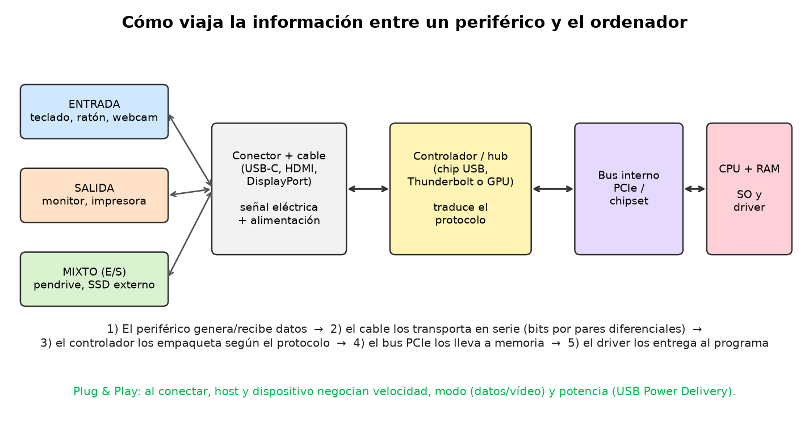
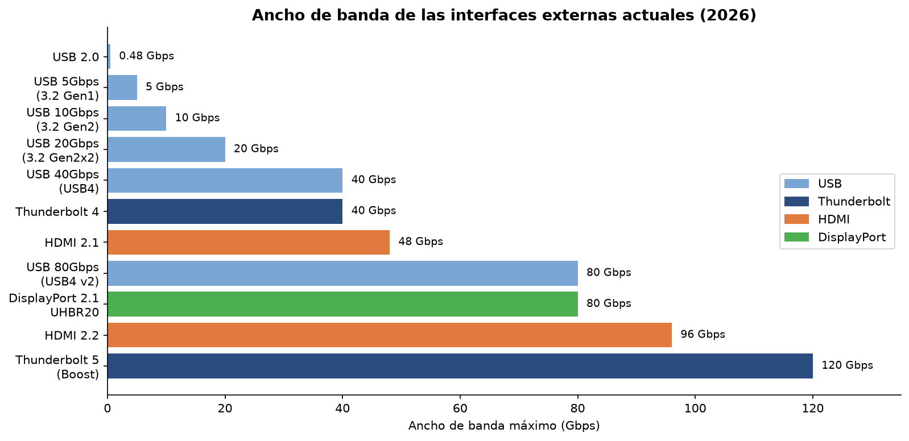
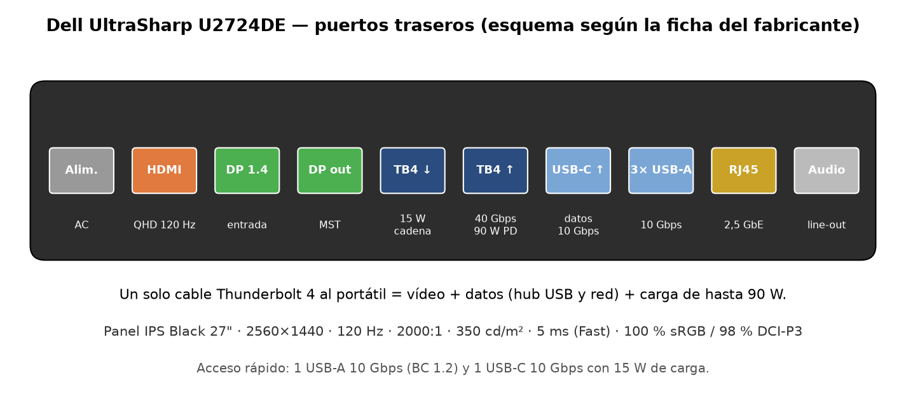

# Puzzle UT2 · Pieza 13: Periféricos e interfaces externas

**Grupo:** David Membrives Muñoz (@davidmembrives301) · Pablo Huertas Roldán (@pablohuertasroldan)

## 1. Qué es y qué función cumple en el sistema

Un **periférico** es cualquier dispositivo que está fuera de la placa base y del procesador y que permite al ordenador comunicarse con el exterior: con el usuario, con otros equipos o con almacenamiento externo.

Los clasificamos según el sentido en que viaja la información:

- **Entrada:** envían datos al ordenador. Teclado, ratón, webcam, micrófono, escáner, lector de huellas.
- **Salida:** reciben datos del ordenador y los convierten en algo útil para nosotros. Monitor, impresora, altavoces, auriculares.
- **Mixtos (entrada/salida):** hacen las dos cosas. Pantalla táctil, pendrive, disco SSD externo, impresora multifunción, *dock* o estación de acoplamiento.

Una **interfaz externa** es el "puente" entre el periférico y el equipo: el conector físico (la forma del enchufe), el cable y el protocolo (las reglas para entenderse). Hoy las más importantes son **USB**, **Thunderbolt**, **HDMI** y **DisplayPort**. Una idea clave que hemos aprendido: **la forma del conector no dice la velocidad**. Un puerto USB-C puede ir a 480 Mbps o a 80 Gbps según lo que haya detrás. Lo dice el propio USB-IF: USB Type-C es un conector, no una velocidad ni un sistema de carga ([USB-IF, pautas de USB4](https://www.usb.org/sites/default/files/usb4_language_product_and_packaging_guidelines_final__0.pdf)).

## 2. Cómo funciona por dentro

El esquema resume el camino de un dato:

1. **El periférico** genera (o recibe) los datos. El teclado tiene un pequeño microcontrolador que detecta qué tecla se ha pulsado y la convierte en un código.
2. **El cable** transporta los bits **en serie**, uno detrás de otro, por pares de hilos diferenciales (dos hilos con señales opuestas, así se cancela el ruido).
3. **El controlador** (el chip USB o Thunderbolt de la placa, o la tarjeta gráfica en el caso de HDMI y DisplayPort) empaqueta y desempaqueta los datos según el protocolo.
4. **El bus interno PCIe** y el chipset llevan esos datos a la memoria RAM.
5. **El sistema operativo y el driver** los entregan al programa que los necesita.

Cuando conectamos algo se produce una **negociación (Plug & Play)**: el ordenador (host) pregunta al dispositivo qué es, qué velocidad soporta y cuánta energía necesita. Con USB-C, además, el cargador y el dispositivo negocian la potencia mediante **USB Power Delivery (USB PD)**.

USB-C también permite el **modo alternativo (Alt Mode)**: por el mismo conector pueden viajar datos USB y una señal de vídeo DisplayPort. **USB4** se basa en el protocolo Thunderbolt que Intel cedió y permite compartir el ancho de banda entre varios protocolos de datos y vídeo a la vez ([USB-IF, USB4](https://www.usb.org/usb4)).

## 3. Características, unidades y cómo se miden

| Característica | Unidad | Valores típicos hoy | Qué significa |
|---|---|---|---|
| Ancho de banda | Gbps (gigabits por segundo) | 5-80 Gbps (USB), hasta 120 Gbps (TB5) | Cuántos datos pasan por segundo. Ojo: bits, no bytes (10 Gbps ≈ 1,25 GB/s teóricos) |
| Potencia de carga | W (vatios) | 15 W, 60 W, 100 W, 240 W | Energía que puede dar el puerto o el cargador (V × A) |
| Resolución | píxeles (ancho × alto) | 1920×1080, 2560×1440, 3840×2160 | Cantidad de puntos de la imagen |
| Frecuencia de refresco | Hz | 60, 120, 144, 240 Hz | Imágenes por segundo que muestra el monitor |
| Tiempo de respuesta | ms | 1-5 ms | Lo que tarda un píxel en cambiar de color; poco = menos estelas |
| Brillo | cd/m² (nits) | 250-400 (oficina), más de 600 (HDR) | Luminosidad de la pantalla |
| Contraste | relación X:1 | 1000:1 (IPS), 2000:1 (IPS Black), 3000:1 (VA) | Diferencia entre el blanco y el negro |
| Densidad de píxeles | PPI | 90-110 en monitores de 24-27" | Nitidez: más PPI, letra más fina |
| Gama de color | % de sRGB / DCI-P3 | 99-100 % sRGB | Cuántos colores reales puede reproducir |

**Cómo se miden:** el ancho de banda se comprueba copiando un archivo grande a un SSD externo (con CrystalDiskMark en Windows, por ejemplo) y siempre sale algo menos que el teórico por la codificación y el protocolo. La potencia se puede ver con un medidor USB-C (un "tester" que se pone entre el cargador y el cable). Los Hz reales del monitor se ven en la configuración de pantalla del sistema operativo o en webs de prueba como TestUFO.

## 4. Tipos, evolución y estándares actuales

**USB.** Es la interfaz universal. Ha pasado por USB 1.1 (12 Mbps), USB 2.0 (480 Mbps), USB 3.x y USB4. Como los nombres técnicos (USB 3.2 Gen 2x2, SuperSpeed+…) confundían mucho, el USB-IF recomienda ahora anunciar directamente la velocidad: **USB 5Gbps, USB 10Gbps, USB 20Gbps, USB 40Gbps y USB 80Gbps** ([USB-IF, guía de rendimiento](https://www.usb.org/sites/default/files/usb_data_performance_language_usage_guidelines_jan_2024.pdf)). USB4 versión 2.0 llega a 80 Gbps usando codificación PAM3 y, de forma opcional, puede ir de forma asimétrica a 120 Gbps en un sentido y 40 Gbps en el otro ([USB-IF, anuncio USB 80Gbps](https://usb.org/sites/default/files/2022-10/USB-IF%20USB%2080Gbps%20Announcement_FINAL_v2.pdf)). En cuanto a la carga, **USB PD 3.1** subió el máximo de 100 W a **240 W** con nuevas tensiones de 28, 36 y 48 V ([USB-IF, USB PD](https://www.usb.org/usb-charger-pd)).

**Conectores USB:** USB-A (el rectangular de siempre), USB-B (impresoras), Micro-USB (móviles antiguos) y **USB-C**, que es reversible y el estándar actual.

**Thunderbolt.** Es la interfaz de Intel que usa el conector USB-C. Thunderbolt 4 da 40 Gbps y hasta 100 W. **Thunderbolt 5** duplica a 80 Gbps bidireccionales, puede subir a **120 Gbps con *Bandwidth Boost*** cuando hay mucho tráfico de vídeo, carga hasta 240 W y admite dos monitores 8K ([Intel, Thunderbolt](https://www.intel.com/content/www/us/en/architecture-and-technology/thunderbolt/overview.html)). Su ventaja frente a USB es que exige unos mínimos: un puerto Thunderbolt siempre tiene vídeo, PCIe y una velocidad garantizada.

**HDMI.** Es la interfaz de vídeo y audio de televisores, consolas y proyectores. HDMI 2.1 ofrece 48 Gbps con el cable *Ultra High Speed*. **HDMI 2.2** (junio de 2025) dobla a **96 Gbps**, admite 4K a 240 Hz y 8K a 60 Hz sin comprimir, y necesita el nuevo cable **Ultra96** ([HDMI Forum](https://www.hdmi.org/spec/hdmi2)).

**DisplayPort.** Es el estándar de VESA pensado para monitores de PC. Permite **MST**, es decir, encadenar varios monitores con un solo puerto. **DisplayPort 2.1 con UHBR20** llega a **80 Gbps** con cuatro carriles de 20 Gbps y requiere cables certificados **DP80** ([DisplayPort.org](https://www.displayport.org/)).

**Monitores.** Los paneles más comunes son **IPS** (buenos colores y ángulos), **VA** (mejor contraste) y **TN** (rápido pero peor color, casi en desuso), además de **OLED/QD-OLED** (negros perfectos y respuesta casi instantánea, pero más caros y con riesgo de quemado).

## 5. Un modelo real: ficha técnica interpretada

**Modelo:** Dell UltraSharp 27 Thunderbolt Hub Monitor U2724DE ([ficha del fabricante](https://www.delltechnologies.com/assetlink/doc/en-us/dell-ultrasharp-27-thunderbolt-hub-monitor-u2724de-datasheet-en-dl1lpw2-original.pdf))

Lo elegimos porque junta las dos partes de la pieza: es un periférico de salida y trae casi todas las interfaces estudiadas.

| Dato de la ficha | Qué significa | ¿Es bueno? ¿Para qué uso? |
|---|---|---|
| 27", 2560×1440 (QHD), 108,97 PPI | Más espacio de trabajo que Full HD con buena nitidez | Muy bueno para oficina, programación y diseño |
| 120 Hz | Muestra 120 imágenes por segundo | Bueno: el desplazamiento es más fluido. Para jugar en serio se buscan 144-240 Hz |
| Panel IPS Black, contraste 2000:1 | IPS con negros más profundos (el IPS normal ronda 1000:1) | Muy bueno para un IPS |
| Brillo 350 cd/m² | Luminosidad típica | Suficiente para oficina; no es un monitor HDR |
| Respuesta 5 ms (modo Fast) | Velocidad del píxel | Correcto para oficina; los monitores gaming bajan a 1 ms |
| 100 % sRGB, 98 % DCI-P3 | Reproduce colores de web y de cine digital | Muy bueno para fotografía y vídeo |
| Thunderbolt 4 de subida con 90 W | Un solo cable da vídeo, datos y carga el portátil | Excelente para portátiles de hasta 90 W |
| Thunderbolt 4 de bajada (15 W) | Permite encadenar un segundo monitor | Útil para tener dos pantallas con un cable |
| HDMI (QHD 120 Hz) + DP 1.4 de entrada + DP de salida | Entradas para sobremesa y consola; la salida DP sirve para encadenar | Versátil. HDMI y DP 1.4 no son la última versión, pero sobran para QHD 120 Hz |
| Hub USB 10 Gbps (USB-A y USB-C) + RJ45 2,5 GbE | El monitor hace de dock: teclado, ratón y red se conectan a él | Muy práctico en un puesto de trabajo |

**Nuestra conclusión:** es un monitor de oficina y creación de contenido muy completo. Su punto fuerte no es la velocidad para juegos, sino que sustituye a un *dock*: con un solo cable Thunderbolt 4 el portátil tiene pantalla, USB, red cableada y carga ([Dell, página del producto](https://www.dell.com/en-us/shop/dell-ultrasharp-27-thunderbolt-hub-monitor-u2724de/apd/210-bksj/monitors-monitor-accessories)). No lo recomendaríamos para un jugador competitivo: ahí convendría un monitor de 144-240 Hz con DisplayPort 2.1 o HDMI 2.1.

## 6. Averías típicas y errores al elegirla o instalarla

- **"El cable USB-C no da imagen".** Es el error más común. Muchos cables USB-C solo sirven para cargar o van a USB 2.0. Para vídeo hay que usar un cable que soporte Alt Mode, Thunderbolt o USB 40Gbps/80Gbps, y el puerto del portátil también tiene que tener salida de vídeo (normalmente se indica con el logo de DisplayPort o del rayo).
- **El monitor va a 60 Hz en vez de 120/144 Hz.** Pasa por usar un cable o puerto antiguo (HDMI 1.4) o porque no se ha cambiado la frecuencia en la configuración de pantalla de Windows. También al conectarlo a la placa base en vez de a la tarjeta gráfica.
- **El portátil carga lento o sale el aviso "cargador lento".** El cargador o el cable dan menos vatios de los que necesita el equipo. Un cable de 60 W no sirve para 100 W o 240 W: hay que mirar la potencia que trae impresa.
- **El dispositivo USB se desconecta solo.** Puede deberse a un hub sin alimentación propia, al ahorro de energía de USB en Windows o a un puerto delantero mal conectado al conector interno de la placa.
- **Pagar por algo que no se usa.** Comprar un cable HDMI 2.2 para una tele de 60 Hz o un SSD de USB 40Gbps para un PC que solo tiene USB 5Gbps: siempre manda el eslabón más lento (puerto, cable o dispositivo).
- **Daños físicos.** Conectores USB-C flojos por tirar del cable, pines doblados en DisplayPort al sacarlo sin pulsar la pestaña, y píxeles muertos o *backlight bleeding* (fugas de luz) en los monitores.
- **Drivers.** Algunos periféricos (impresoras, tabletas gráficas, docks DisplayLink) necesitan un driver del fabricante; si no se instala, funcionan mal o no funcionan.

## 7. Fuentes

1. USB-IF. *USB Data Performance Language Usage Guidelines* (2024) y *USB Charger (USB Power Delivery)*. https://www.usb.org/sites/default/files/usb_data_performance_language_usage_guidelines_jan_2024.pdf · https://www.usb.org/usb-charger-pd
2. Intel. *Thunderbolt Technology Overview* y *Thunderbolt 5 Technology Brief*. https://www.intel.com/content/www/us/en/architecture-and-technology/thunderbolt/overview.html
3. HDMI Forum. *HDMI 2.2 Specification Technology Overview*. https://www.hdmi.org/spec/hdmi2
4. VESA. *DisplayPort 2.1* y cables DP80. https://www.displayport.org/
5. Dell. *Dell UltraSharp 27 Thunderbolt Hub Monitor U2724DE – Datasheet*. https://www.delltechnologies.com/assetlink/doc/en-us/dell-ultrasharp-27-thunderbolt-hub-monitor-u2724de-datasheet-en-dl1lpw2-original.pdf

## Uso de IA

Usamos un asistente de IA para organizar la estructura del trabajo, proponer las preguntas tipo test y generar los esquemas de la carpeta `img/` con Python (matplotlib). **Cómo comprobamos sus respuestas:** cada número (velocidades, vatios, datos del monitor) lo contrastamos con la web oficial del organismo que publica el estándar (USB-IF, Intel, HDMI Forum, VESA) y con la ficha técnica de Dell. Cuando la IA mezclaba nombres antiguos y nuevos de USB, nos quedamos con los nombres oficiales actuales del USB-IF. Después reescribimos los textos con nuestras palabras para poder explicarlos en la exposición.
